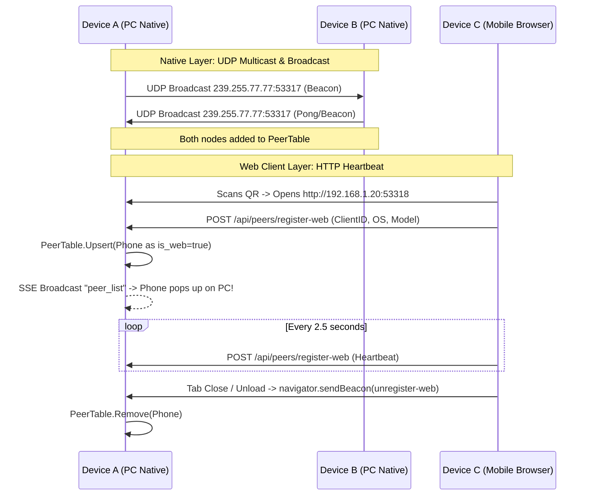
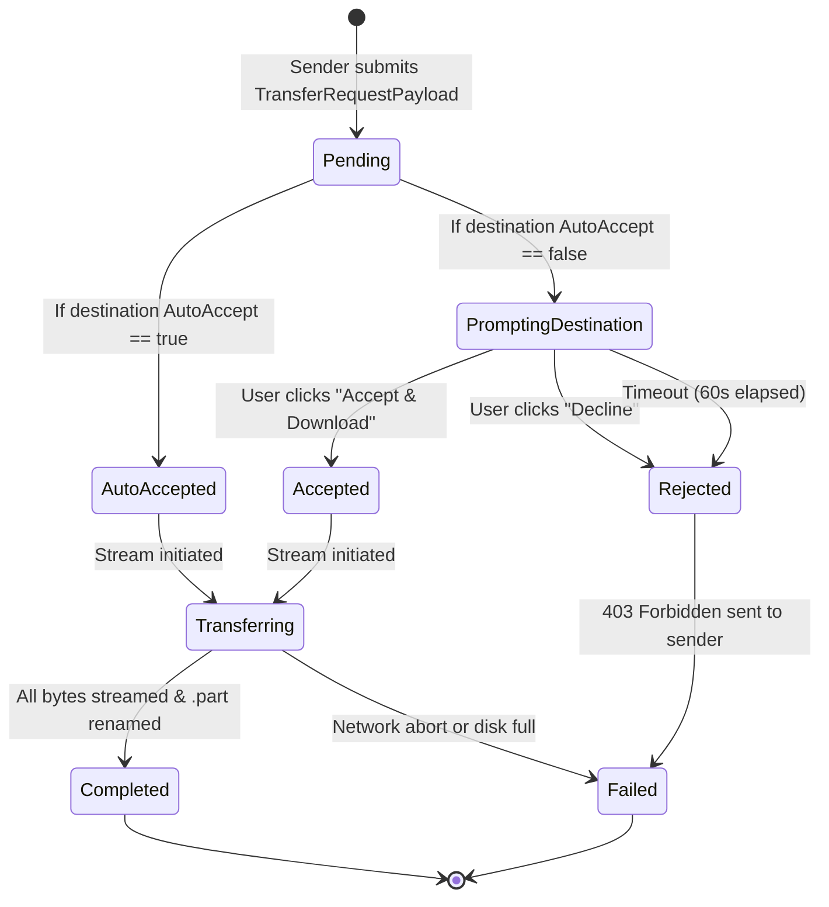

# SendFile - System Architecture & Process Deep Dive (`CONTEXT.md`)

This document provides an exhaustive technical breakdown of **SendFile**—detailing the internal protocols, networking daemons, state machines, and streaming pipelines that power peer-to-peer local Wi-Fi file transfers between desktops, laptops, and mobile devices.

---

## 1. High-Level Architectural Model

SendFile operates as a decentralized, local-first system. It eliminates external cloud intermediaries, internet dependencies, and account authentication, ensuring that all data transfers remain strictly within the local subnet at physical Wi-Fi speeds.

```
┌────────────────────────────────────────────────────────────────────────┐
│                          SendFile Architecture                         │
├────────────────────────────────────────────────────────────────────────┤
│ 1. Network Discovery Layer                                             │
│    • UDP Multicast (239.255.77.77:53317) & Subnet Broadcasts          │
│    • Physical Wi-Fi interface auto-detection & virtual IP filtering    │
│    • Web Peer Heartbeat Engine (HTTP POST /api/peers/register-web)     │
├────────────────────────────────────────────────────────────────────────┤
│ 2. Peering & Telemetry Registry                                        │
│    • Thread-safe In-Memory Peer Table with 7s TTL garbage collection   │
│    • Server-Sent Events (SSE) live push broker (/api/events)           │
├────────────────────────────────────────────────────────────────────────┤
│ 3. Transfer & Security Engine                                          │
│    • Destination-Only Handshake (Accept / Decline dialog)             │
│    • Path Traversal Sanitization & Duplicate File Auto-Indexing        │
│    • O(1) RAM Chunked Multipart Streaming via io.Pipe & io.Copy       │
│    • Atomic Write Mechanism (.part buffer -> atomic OS rename)         │
├────────────────────────────────────────────────────────────────────────┤
│ 4. Embedded Cross-Platform Frontend                                    │
│    • Zero external runtime dependencies (Go //go:embed)                │
│    • Mobile-responsive segmented navigation tabs (≤ 768px)             │
│    • iOS/Android native bottom-sheet modal behaviors                   │
└────────────────────────────────────────────────────────────────────────┘
```

---

## 2. Process Breakdown

### Process 1: Network & Interface Detection

* **Source File:** [`internal/config/config.go`](file:///c:/Users/apurv/OneDrive/Desktop/Downloads/SendFile/internal/config/config.go)
* **Function:** `GetLocalIPs()`

#### The Problem
Modern operating systems (especially Windows 10/11) host multiple virtual and tunnel network adapters (e.g., Windows Mobile Hotspot at `192.168.137.1`, WSL/Hyper-V vEthernet, VMware, VirtualBox). If a file transfer server naively picks the first IP returned by `net.InterfaceAddrs()`, it often binds to a virtual network that phones and external devices on the physical Wi-Fi cannot reach.

#### How It Works
1. **Interface Enumeration:** Scans all system network interfaces via `net.Interfaces()`.
2. **Flag Validation:** Filters out interfaces that are down (`iface.Flags & net.FlagUp == 0`) or loopback (`net.FlagLoopback`).
3. **Virtual Adapter Filtering:** Flags and suppresses virtual network adapters by checking for:
   * Interface names containing `virtual`, `vethernet`, `vbox`, `vmware`, or wildcard asterisks (`*` like `Local Area Connection* 2`).
   * Default virtual subnet blocks (e.g., `192.168.137.x` and APIPA `169.254.x.x`).
4. **Physical Wi-Fi Prioritization:** 
   * Searches for interfaces containing `wi-fi`, `wifi`, or `wlan` and sets their IPv4 address as the primary LAN IP.
   * Falls back to physical Ethernet (`eth`, `ethernet`, `en`) if Wi-Fi is unavailable.
5. **Subnet Broadcast Resolution:** Computes the bitwise subnet broadcast address (`ip | ~mask`) for every active interface to ensure discovery packets traverse routers with strict directed-broadcast rules.

---

### Process 2: Zero-Config Device Discovery

* **Source Files:** [`internal/discovery/beacon.go`](file:///c:/Users/apurv/OneDrive/Desktop/Downloads/SendFile/internal/discovery/beacon.go), [`internal/discovery/peer_table.go`](file:///c:/Users/apurv/OneDrive/Desktop/Downloads/SendFile/internal/discovery/peer_table.go)

SendFile employs a **dual-layer discovery architecture** to support both native executables and sandboxed mobile web browsers.



#### Layer 1: Native App Peer Discovery (UDP Multicast & Broadcast)
* **Multicast Group:** `239.255.77.77:53317`
* **Broadcast Port:** UDP `53317`
* **Mechanism:**
  * Uses `net.ListenMulticastUDP` which enables multiple instances on the same host or network to bind without `SO_REUSEADDR` port collisions.
  * Concurrently transmits JSON beacon packets every 2.5 seconds to both multicast and interface subnet broadcast addresses.
  * Beacon Packet Schema:
    ```json
    {
      "action": "beacon",
      "id": "1564a70734b094f2",
      "name": "Spidey",
      "device_type": "desktop",
      "os": "windows",
      "http_port": 53318,
      "version": "1.0.0"
    }
    ```
  * Self-packets are filtered out via `msg.ID == cfg.NodeID`.
  * On clean process shutdown (`SIGINT` / `SIGTERM`), the node broadcasts an `"action": "leave"` packet so all peers instantly remove it from their UI without waiting for timeout.

#### Layer 2: Mobile / Web Client Discovery (HTTP Registration & Heartbeat)
* **The Constraint:** Web browsers on iOS (Safari) and Android (Chrome) are strictly prohibited by sandbox policies from opening raw UDP sockets.
* **The Solution:**
  1. When a phone scans the QR code and opens `http://<PC-IP>:53318`, `app.js` generates a persistent `client_id` in `localStorage`.
  2. The mobile browser inspects `navigator.userAgent` to determine device model (e.g. `Apple iPhone`, `Android Phone`, `Apple iPad`).
  3. The phone sends `POST /api/peers/register-web` with its metadata.
  4. The host server extracts the remote IP from `r.RemoteAddr`, marks the peer with `IsWeb: true`, and injects it into the in-memory `PeerTable`.
  5. The host fires an SSE `peer_list` update, instantly rendering the phone with a `📱 PHONE` card on the PC screen.
  6. The phone maintains registration by sending heartbeats every 2.5 seconds. If the user closes the mobile tab, `beforeunload` fires `navigator.sendBeacon('/api/peers/unregister-web')`, removing it immediately.

#### In-Memory Peer Table (`PeerTable`)
* Protected by `sync.RWMutex`.
* A background cleaner loop runs every 2 seconds. Any peer whose `LastSeen` timestamp exceeds 7 seconds is automatically evicted.
* Any mutation triggers the `onPeerListChange` callback, which broadcasts the updated list to all active UI screens via SSE.

---

### Process 3: Security & Transfer Handshake

* **Source Files:** [`internal/server/handlers.go`](file:///c:/Users/apurv/OneDrive/Desktop/Downloads/SendFile/internal/server/handlers.go), [`internal/transfer/manager.go`](file:///c:/Users/apurv/OneDrive/Desktop/Downloads/SendFile/internal/transfer/manager.go)



#### Strict Destination-Only Authorization Rule
* **The Security Principle:** Only the device whose disk is being written to should ever display the Accept/Decline authorization dialog.
* **Implementation:**
  * When a transfer request arrives at `POST /api/transfer/request` or `POST /api/direct-upload`, the payload includes the sender's `client_id`.
  * The server marks the session with `Direction: "receive"` and `PeerID: SenderID`.
  * In the frontend (`app.js`):
    * If `isGuestClient()` is true (the phone), the Accept/Decline modal is suppressed.
    * If `session.peer_id === state.myClientId`, the prompt is suppressed because this device was the initiator.
    * Therefore, the prompt appears **only** on the destination device.

#### Two-Phase Lightweight Handshake (< 10ms Prompt)
* **The Problem:** Previously, uploading files from a browser pushed the entire multipart body (often gigabytes of data) to the server *before* asking the destination to accept or decline. On large files (e.g. 2.5 GB video), the destination did not see the prompt until the entire 2.5 GB finished uploading over Wi-Fi!
* **The Solution:** SendFile separates transfer into two distinct phases:
  1. **Phase 1: Metadata Pre-Flight (300 Bytes JSON):** 
     The sender immediately extracts `name`, `size`, and `mime-type` from the file headers and sends a lightweight JSON packet to `POST /api/transfer/request`. Because this payload is tiny (~300 bytes), the destination screen receives it in **< 10ms** and immediately pops up the Accept/Decline modal.
  2. **Phase 2: Payload Streaming:**
     Only after the destination clicks "Accept" does the sender begin transmitting file bytes over HTTP. If the destination clicks "Decline", **zero bytes** of payload data are transferred over the network.
  3. **Staging Auto-Clear:**
     As soon as the transfer is initiated and accepted, the sender's staged files array is reset and the native `<input type="file">` element is cleared (`el.fileInput.value = ''`). This immediately clears the dropzone area so subsequent files can be queued without manual removal or browser file selection conflicts, while live transmission progress is monitored under the **Activity** tab.

#### Interactive Decision Channel
If Auto-Accept is disabled:
1. `TransferManager.HandleIncomingRequest` creates a channel `pendingDecisions[transferID] chan bool`.
2. The server holds the HTTP connection and awaits user input.
3. The destination user sees the modal showing:
   * Sender device name and IP
   * Total size formatted (e.g. `24.9 MB`)
   * List of file names and item counts
4. The user's choice calls `POST /api/transfer/decision` with `{ transfer_id, accepted: true/false }`.
5. The boolean is sent through the channel; if no response is given within 60 seconds, it automatically times out and defaults to `false`.

#### Path Traversal Defense & Name Collision Handling
* **Sanitization:** To prevent malicious path injection (e.g., `../../../../Windows/System32/evil.dll`), every incoming filename passes through `filepath.Base()`.
* **Safe Duplicate Naming:** If `photo.jpg` already exists in the save folder, the engine checks existence with `os.Stat` and increments an index: `photo (1).jpg`, `photo (2).jpg`, ensuring zero data loss.

---

### Process 4: High-Throughput Streaming Engine

* **Source File:** [`internal/transfer/manager.go`](file:///c:/Users/apurv/OneDrive/Desktop/Downloads/SendFile/internal/transfer/manager.go)
* **Function:** `SaveUploadedFile()` & `executeUploads()`

Traditional HTTP file upload handlers often read the entire file into memory (`ioutil.ReadAll` or large multipart memory buffers), which exhausts RAM when transferring multi-gigabyte files (e.g., 4K videos or large disk images). SendFile uses **zero-buffer streaming**.

```
Sender Disk -> os.Open -> io.PipeWriter 
                                │ (Chunked HTTP Stream)
                                ▼
Destination Network Socket -> io.PipeReader -> 64KB Buffer -> Destination File (.part)
```

1. **Streaming Upload (`executeUploads`):**
   * Uses `io.Pipe()` to connect an `io.PipeWriter` directly to `multipart.Writer`.
   * Files are read from disk in 64KB buffers and piped directly into the HTTP request body. Go's `net/http` automatically transmits this with `Transfer-Encoding: chunked`.
2. **Streaming Ingestion (`SaveUploadedFile`):**
   * The destination server reads parts directly from the HTTP multipart stream.
   * Data is written directly to a staging file with a `.part` extension (`filename.part`).
   * Memory usage remains fixed at **64 KB** throughout the entire transfer, regardless of whether the file is 10 MB or 100 GB.
3. **Atomic File Finalization:**
   * Only after the stream reaches `io.EOF` and the file is flushed to disk does the engine call `os.Rename(partPath, targetPath)`.
   * If a connection drops midway, the incomplete `.part` file is deleted, ensuring no corrupted or partial files are ever placed in the destination folder.

---

### Process 5: Two-Way Transfer Mechanics

SendFile handles three distinct transfer paths seamlessly:

#### Case A: Phone ➔ PC (Mobile Upload)
1. The user on the phone opens the web UI and selects files via the file picker.
2. The phone submits a multipart form to `POST /api/direct-upload` with `target.isHost = true` and `client_id = state.myClientId`.
3. The PC server checks its Auto-Accept setting:
   * If enabled: Instantly writes the files to `C:\Users\<user>\Downloads\SendFile`.
   * If disabled: Displays the Accept/Decline modal on the PC screen.
4. Live progress updates stream over SSE to both devices.

#### Case B: PC ➔ Phone (Desktop to Mobile)
1. On the PC, the user selects the phone card from **Nearby Wi-Fi Devices** (`IsWeb: true`) and clicks **Send Files**.
2. The PC server stages the files locally and registers an outbound session.
3. The server broadcasts an SSE event `web_download_offer` targeting the phone's `client_id`.
4. The phone's browser catches the event:
   * If mobile Auto-Accept is enabled: Immediately triggers the file downloads directly to the phone's browser downloads.
   * If mobile Auto-Accept is disabled: Displays a **"Files Received! [Save Files]"** modal.
5. The phone streams each file from `GET /api/download?transfer_id=...&file_index=...`.

#### Case C: PC ➔ PC (Native Binary to Native Binary)
1. Device A sends `POST http://<Device_B_IP>:53318/api/transfer/request`.
2. Device B prompts the user and responds with `accepted: true`.
3. Device A streams the payload directly to Device B's `POST /api/transfer/upload?transfer_id=...`.

---

### Process 6: Real-Time Telemetry & SSE Architecture

* **Source File:** [`internal/server/sse.go`](file:///c:/Users/apurv/OneDrive/Desktop/Downloads/SendFile/internal/server/sse.go)

SendFile utilizes **Server-Sent Events (SSE)** on `/api/events` to push instantaneous state changes without polling overhead:

* **Subscription Pool:** `SSEBroker` maintains a synchronized client channel map (`map[chan EventMessage]bool`).
* **Non-Blocking Fanout:** When an event is broadcast, slow clients that fail to consume their channel buffer do not block the transfer engine (messages are non-blockingly dropped if full).
* **Speed & ETA Computation:** Every 500ms during an active stream, the transfer manager calculates:
  $$\text{Speed (Bytes/sec)} = \frac{\text{Bytes Transferred in Interval}}{\text{Elapsed Seconds}}$$
  $$\text{ETA (seconds)} = \frac{\text{Total Bytes} - \text{Transferred Bytes}}{\text{Speed}}$$
* **Broadcast Events:**
  * `peer_list`: Emitted when any device joins, leaves, or times out.
  * `transfer_update`: Live byte counts, percentage, speed in MB/s, and ETA.
  * `web_download_offer`: Sent to mobile devices when files are ready for download.

---

### Process 7: Responsive Mobile Frontend Architecture

* **Source Files:** [`internal/ui/static/app.js`](file:///c:/Users/apurv/OneDrive/Desktop/Downloads/SendFile/internal/ui/static/app.js), [`internal/ui/static/style.css`](file:///c:/Users/apurv/OneDrive/Desktop/Downloads/SendFile/internal/ui/static/style.css), [`internal/ui/static/index.html`](file:///c:/Users/apurv/OneDrive/Desktop/Downloads/SendFile/internal/ui/static/index.html)

The frontend is written in pure vanilla HTML5, CSS3, and modern JavaScript, embedded into the Go executable via `//go:embed static/*`.

#### Mobile Navigation & Segmented Control (Screens $\le 768\text{px}$)
* **Tab Switcher:** Rather than stacking long scrollable panels, mobile devices switch between two views:
  1. **📤 Send Files:** Peer cards + File Picker Dropzone.
  2. **⚡ Activity:** Live streaming status, progress bars, and folder shortcuts.
* **Auto-Tab Slide:** When a user taps "Send Files" on mobile, the UI automatically transitions to the **Activity** tab to display live progress bars immediately.
* **Touch-Optimized Peer Grid:** Renders in a 2-column touch grid with compact 40px avatars.
* **Native Bottom Sheets:** Modals on mobile slide up from the bottom of the screen (`animation: mobileSheetUp`) with full-width 48px thumb targets.
* **Input Zoom Prevention:** Form inputs explicitly set `font-size: 16px` to prevent iOS Safari from automatically zooming into the page on focus.
* **Safe Area Support:** Layouts include `env(safe-area-inset-bottom)` and `env(safe-area-inset-top)` for iPhone notches and gesture navigation bars.

---

## 3. Storage Hierarchy

```
C:\Users\<Username>\Downloads\SendFile\
├── photo.jpg                      # Successfully finalized file
├── photo (1).jpg                  # Auto-indexed duplicate
├── video.mp4.part                 # In-flight active stream (temporary)
└── document.pdf                   # Finalized document
```

* **Staging Phase:** All in-flight transfers write to `<filename>.part`.
* **Finalization Phase:** On stream completion, the file is atomically renamed to its clean destination filename.
* **1-Click Inspection:** The UI endpoint `POST /api/open-folder` invokes the host OS's native file explorer (`explorer.exe` on Windows, `open` on macOS, `xdg-open` on Linux) directly to the storage directory.

---

## 4. Summary of Endpoints

| Method | Endpoint | Description |
| :--- | :--- | :--- |
| `GET` | `/` | Serves embedded responsive web application. |
| `GET` | `/api/info` | Returns host node ID, device name, active IP, port, and save directory. |
| `POST` | `/api/settings` | Updates device name, save folder, or global Auto-Accept toggle. |
| `GET` | `/api/peers` | Returns currently active discovered peers. |
| `POST` | `/api/peers/refresh` | Triggers an immediate UDP discovery broadcast ping. |
| `POST` | `/api/peers/register-web` | Mobile browser registration and heartbeat ping. |
| `POST` | `/api/peers/unregister-web` | Mobile browser graceful disconnect via `sendBeacon`. |
| `GET` | `/api/transfers` | Lists active and historical transfer sessions. |
| `POST` | `/api/transfer/request` | Peer-to-peer transfer metadata handshake request. |
| `POST` | `/api/transfer/decision` | Submits Accept or Decline choice for a pending transfer. |
| `POST` | `/api/transfer/upload` | Streams file payload from peer directly to disk. |
| `POST` | `/api/send-direct` | Initiates transfer from local web client to another peer. |
| `POST` | `/api/direct-upload` | Direct upload from mobile browser to host PC storage. |
| `GET` | `/api/download` | Streams staged file from PC storage to mobile browser. |
| `POST` | `/api/open-folder` | Opens host OS File Explorer directly to `Downloads/SendFile`. |
| `GET` | `/api/events` | Server-Sent Events (SSE) real-time streaming endpoint. |
